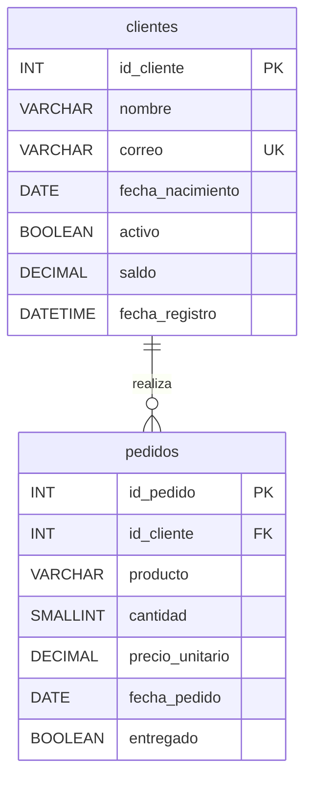

# Actividad Sumativa – Unidad 2: aplicación contenerizada en Docker

Aplicación web de **clientes y pedidos** en dos contenedores independientes:

| Contenedor | Imagen | Qué contiene |
|---|---|---|
| `tienda-db` | `tienda-mysql:1.0` (`db/Dockerfile`) | MySQL 8.0 con las dos tablas creadas por `db/init.sql` |
| `tienda-web` | `tienda-web:1.0` (`web/Dockerfile`) | Servidor Node.js (Express) con la interfaz web |

Los datos se guardan en un **volumen de Docker** (`mysql_data`), por lo que persisten aunque se elimine el contenedor.

## Estructura

```
actividad-docker/
├── 01-demo-basico/Dockerfile   # imagen mínima para la demo de "crear y eliminar imagen"
├── db/
│   ├── Dockerfile              # imagen de MySQL
│   └── init.sql                # SCRIPT DE LA BASE DE DATOS (entregable)
├── web/
│   ├── Dockerfile              # imagen de Node.js
│   ├── server.js               # CÓDIGO FUENTE de la app (entregable)
│   ├── package.json
│   └── public/                 # CSS e imagen que sirve la app
├── docker-compose.yml          # levanta ambos contenedores con un solo comando
├── GUIA_VIDEO.md               # guion del video con los 30+ comandos
└── README.md
```

## Modelo entidad-relación

Un cliente tiene muchos pedidos; cada pedido pertenece a un solo cliente (`pedidos.id_cliente` → `clientes.id_cliente`).



Cada tabla tiene 7 columnas con tipos distintos: entero, carácter, fecha, fecha y hora, booleano y decimal.

## Cómo ejecutarlo

Requisito: Docker Desktop en ejecución.

**Opción A – un solo comando (docker compose)**

```bash
docker compose up -d --build
```

**Opción B – paso a paso con `docker build` y `docker run`** (la usa la guía del video)

```bash
docker build -t tienda-mysql:1.0 ./db
docker build -t tienda-web:1.0 ./web
docker network create red-tienda
docker run -d --name tienda-db --network red-tienda -v mysql_data:/var/lib/mysql -e MYSQL_ROOT_PASSWORD=root_pass -e MYSQL_DATABASE=tienda_db -e MYSQL_USER=app_user -e MYSQL_PASSWORD=app_pass -e TZ=America/Bogota tienda-mysql:1.0
docker run -d --name tienda-web --network red-tienda -p 3000:3000 -e DB_HOST=tienda-db -e TZ=America/Bogota tienda-web:1.0
```

Usa **una** de las dos opciones a la vez (ambas usan los nombres `tienda-db` y `tienda-web`). Si cambias de una a otra, primero elimina los contenedores con `docker rm -f tienda-web tienda-db`.

Luego abre <http://localhost:3000>.

## Páginas de la aplicación

| Ruta | Qué hace |
|---|---|
| `/` | Estado de los dos contenedores (ID, versión de Node y de MySQL, conexión) |
| `/registrar` | Formularios para guardar clientes y pedidos, y botón para cargar 15 + 15 datos de ejemplo |
| `/datos` | Muestra lo que hay guardado en MySQL (enlace distinto al de registro) |
| `/api/datos` | Los mismos datos en JSON |

## Si algo falla

- **La página dice "Sin conexión"**: MySQL tarda unos segundos en arrancar la primera vez. Espera y recarga. Revisa con `docker logs tienda-db`.
- **El puerto 3000 está ocupado**: cambia `-p 3000:3000` por `-p 3001:3000` y entra por `http://localhost:3001`.
- **Cambié `init.sql` y no se refleja**: el script solo corre cuando el volumen está vacío. Borra el volumen (`docker volume rm mysql_data`, con los contenedores eliminados) y vuelve a crear el contenedor.
- **Ver los errores de la app**: `docker logs tienda-web`.
